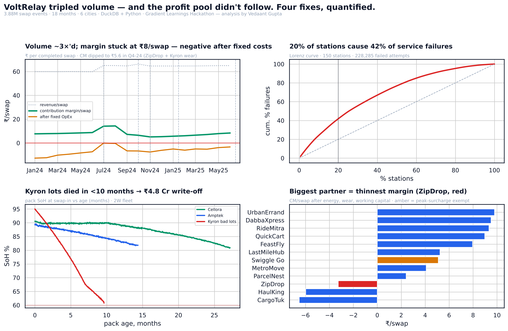

# VoltRelay Energy — Battery-Swap Network Analysis
**Gradient Learnings 1-Day Data Analytics Hackathon** · Vedaant Gupta, IIT Kharagpur

VoltRelay tripled monthly swaps (103k → 303k) in 18 months, yet lost money on every swap after station fixed costs. This project traces why, using 3.88M swap events across 150 stations in 6 Indian cities, and ranks leadership's four budget options.

## Key findings
| | Finding |
|---|---|
| 🔋 Batteries | Kyron lots KY-2407/08/09 hit end-of-life in <10 months → **1,438 packs, ₹4.8 Cr written off (19.7% of fleet CapEx)**. Worn packs delivered 44% less range (68 → 38 km). |
| 📍 Failures | **20% of stations cause 41.8% of failures.** 83 of 150 stations have zero 3W slots → 3W riders fail at 10.9% in meal peaks vs 5.8% for 2W. |
| 🤝 Partners | ZipDrop's discount jumped 12% → 28% on 1 Nov 24, flipping margin **+₹5.7 → −₹7.7 per swap**. Surcharge-exempt partners ran 64% of swaps at peak, avoiding ₹17.4 L in the pilot. |
| 💡 Pricing | Peak pilot DiD: peak share moved only −2.5 pp. It raises revenue (~₹1.6 Cr/yr) but doesn't shift demand. |
| 👤 Retention | An early stockout raises 30-day churn odds 1.46× — the strongest predictor. |

**Recommendation:** batteries + Gen1 charger upgrades first → peak pricing with exemptions closed → renegotiate ZipDrop before any exclusive → no blanket new stations.

## Methods
- **DuckDB** for all heavy SQL (window functions, joins over 3.88M + 1.49M rows); only small aggregates reach Pandas. Runs within Colab's 12 GB.
- **9-rule data hygiene audit**, each rule tested before applied: firmware timezone fix (139,490 rows), retry dedup, city canonicalisation, sensor caps, telemetry gaps never zero-filled, CSAT missing-not-at-random correction, Hinglish/English ticket re-classification (6,020 hidden battery complaints).
- **Battery wear** from per-pack lifetime SoH consumption (₹37/swap). A per-trip estimator was rejected after showing sensor noise biases it ~5×.
- **Difference-in-differences** on a stable station panel for the pricing pilot; **exposure-adjusted logistic regression** for churn.

## Files
| File | Contents |
|---|---|
| `VoltRelay_Hackathon_Analysis.ipynb` | Full executed notebook (41 cells, 14 figures) |
| `VoltRelay_Analysis_Report.md` | Written report incl. budget decision matrix |
| `VoltRelay_3Min_Video_Script.md` | Timestamped presentation script |
| `key_numbers.json` | Every headline figure, as produced by the notebook |
| `figures/` | All charts as PNG |

## Reproduce
Data is not included (provided by the organisers, ~837 MB). Place the 8 CSVs (`.csv` or `.csv.gz`) next to the notebook or in `./data/` and run all cells (~5 min).

**Stack:** DuckDB · Python · Pandas · Matplotlib · Seaborn · scikit-learn
